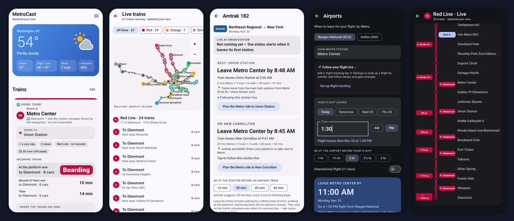
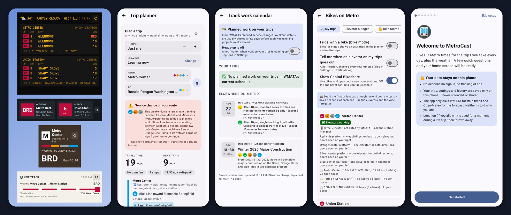

# MetroCast

A free, ad-free Android app for riding DC Metro: live trains, track work alerts, Amtrak / MARC / VRE
connections, and getting to Reagan National and Dulles. No account, no ads, no tracking: everything
stays on your phone. Open source.

**[⬇ Download MetroCast 1.23 (APK, 2.4 MB)](download/MetroCast-1.23.apk?raw=true)**

> Unofficial. MetroCast is not made by, or affiliated with, WMATA (Metro), Amtrak, MARC or VRE.
> Train data provided by WMATA.



## What it does

- **Your trips on the home screen**: the next trains for the trips you take, with where they are right now.
- **Trip planner**: any station to any station, transfers, ride time and fare; follow a trip live with a heads-up before each transfer.
- **Live trains**: every train on every line, on a map.
- **Track work calendar**: planned work on your trips, with an optional heads-up a few days ahead.
- **Amtrak, MARC & VRE**: pick your train (or your line) and it tells you which Metro station to go to, when to leave, and whether the train is on time.
- **Airports**: Reagan National and Dulles. Enter your flight time and it tells you when to leave. Live flight status is optional (needs your own key from AviationStack or FlightAware).
- **Home-screen widgets**: a departure board, next train, a station pylon, and a live track.
- **Also**: restrooms, bikes (elevators, bike rooms, Capital Bikeshare), Metro Police contacts, special trains and events, scenic rides, weather, light and dark themes, 12/24-hour clock, offline notice.



## Privacy

- No account, no ads, no analytics.
- Your location is never saved or sent anywhere.
- Your trips and settings stay on your phone.
- The app talks to WMATA (train times), Open-Meteo (weather), and — only if you use those features — Capital Bikeshare, Amtrak/MARC/VRE schedule feeds, and the flight service you choose.

## Install

1. Download **MetroCast-1.23.apk** (link above) on your Android phone (Android 8.0 or newer).
2. Open it. Android will ask you to allow installing apps from your browser or Files app: allow it, then tap **Install**.
   - It's not from the Play Store, so Android may show a warning or have Play Protect scan it. That's expected for apps installed this way.
   - Have 1.20 from here? Just install 1.23 over it: your trips and settings stay.
   - Have 1.19 from here? Uninstall it first: 1.20 and later are signed with a new key (a one-time change).
3. Open MetroCast. A short setup asks for your usual stations and (optionally) your ZIP code for weather.

### Get your free WMATA key (about 2 minutes)

MetroCast gets live train times straight from WMATA, which needs a free key:

1. Sign up at **https://developer.wmata.com**.
2. Go to **Products**, choose **Default Tier**, and subscribe (free).
3. Open your **Profile**, copy your **Primary key**.
4. Paste it into MetroCast when setup asks (or later in **Settings → WMATA API key**).

## Checking the download

SHA-256 of `MetroCast-1.23.apk`:

```
4bea9ffef826c9edfcd0fa4b4864a71aa450e6c3d52c605d3907763c353c420a
```

Signing certificate (SHA-256): `9e55cbc7f242ab9a9907a7436fbab7d058e9ca6769a0428210f4a5f9ab399cf1`

## Build it yourself

Requirements: Android Studio (or the Android SDK) and JDK 17.

```bash
./gradlew assembleDebug        # app/build/outputs/apk/debug/app-debug.apk
./gradlew testDebugUnitTest    # the test suite (Robolectric; recorded data, never the network)
```

To build your WMATA key in (instead of typing it into the app), create `private.properties` here:

```properties
wmataKey=your-key-here
# Optional: the trips and weather spot the app starts with (line|from code|from name|to code|to name|place|lat|lon)
startDefaults=RD|A01|Metro Center|B03|Union Station|Washington, DC|38.8983|-77.0281
```

`private.properties`, `signing.properties` and keystores are in `.gitignore`: never commit them. Without
`signing.properties`, release APKs are unsigned. Build options: `-PpublicBuild` (no key, neutral
starting trips), `-Prail=false`, `-Pairports=false`, `-Pflights=aviationstack|flightaware`.

**Where things are:** `app/src/main/java/com/metrocast/app/` has `data/` (WMATA API, caching, settings,
Amtrak/MARC/VRE, flights, track work…), `ui/` (one file per screen, Jetpack Compose) and `widget/`
(Glance widgets). Tests are in `app/src/test/`, with recorded real data in `src/test/resources`.

**Data sources:** WMATA, Open-Meteo, Capital Bikeshare (GBFS), Amtrak / MARC (MDOT MTA) / VRE published
schedules and live feeds, Amtraker (Amtrak live status), and optionally AviationStack or FlightAware.

## Feedback

Found a bug or have an idea? Open an issue on this page.
